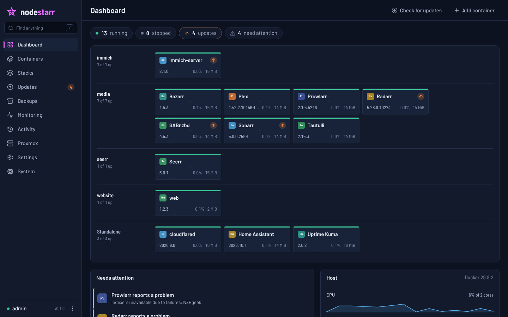
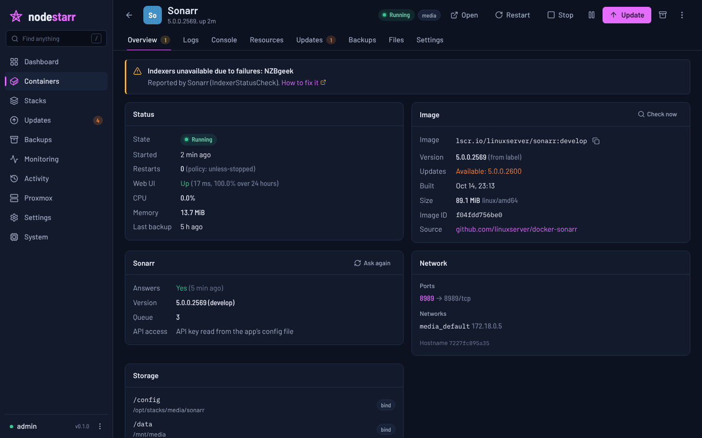
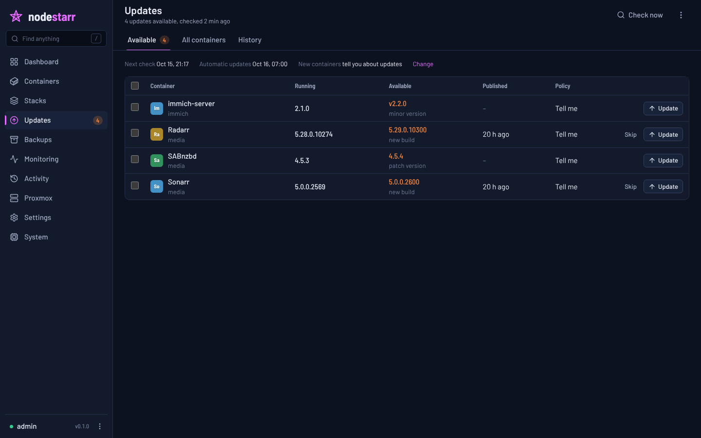
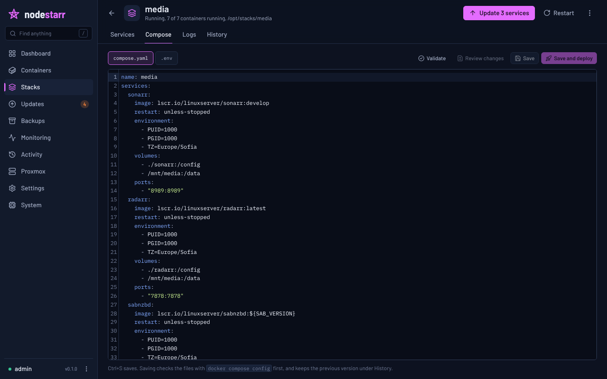
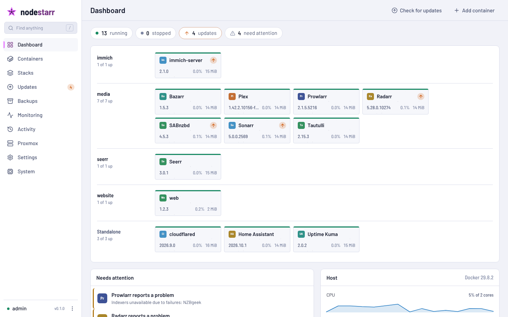

<p align="center">
  
</p>

<h1 align="center">Nodestarr</h1>

<p align="center">
  Monitor, update and back up the Docker containers and Compose stacks on your server,<br>
  from one fast, friendly web UI in the style of the *arr apps.
</p>



Nodestarr is the hub of your server: it sees every container, knows which
ones have updates, backs up their configs and databases, and lets you fix
whatever looks wrong in one click. It is a single small binary (Rust, with a
Svelte UI built in) that idles at about 20 MB of memory and almost no CPU.

## Features

**Containers and stacks**
- Finds every container and Compose stack on its own, including stacks that
  aren't running, and keeps the list live through Docker's event stream.
- Name, version, update status, state, uptime, CPU and memory at a glance,
  as a table or a dashboard grid grouped by stack.
- One-click start, stop, restart, pause, recreate, kill, update, back up
  and remove, for single containers, whole stacks or a selection.
- Live logs with search, a "problems only" filter, timestamps and download;
  merged logs for a whole stack.
- A console per container (a real terminal in the browser) and one-off
  commands.
- Compose editor with validation, a diff before saving, deploy, and a
  history of every version. Create stacks from a template or convert a
  `docker run` command.
- Create and edit standalone containers with a full form (ports, volumes,
  environment, limits, devices, GPUs, health checks), or import a
  `docker run` command.
- Config file editor for app files (Sonarr's `config.xml`, `.env`, YAML,
  INI ...) with versions you can compare and restore.

**Updates**
- Checks registries for new builds of the tag you run and for newer version
  tags, with release notes from GitHub.
- Per container: ignore, tell me, or update automatically, limited to new
  builds, patch, minor or major versions, and only once an update has been
  out for a while.
- Change the tag or branch (for example Sonarr `develop`) with a preview of
  the compose change, including tags set through `.env` variables.
- Backs up first, waits for the new container to stay up (and healthy),
  and rolls back automatically if it doesn't. Recent updates can also be
  rolled back by hand from the history.
- Holds, skipped builds, a Plex guard that waits while someone is
  streaming, and Nodestarr updating itself.

**Backups**
- One click or on a schedule: config folders, the stack's compose files,
  consistent database dumps (Postgres, MySQL/MariaDB, MongoDB) and the
  apps' own backups.
- Pauses or stops containers only when needed, skips media and caches,
  keeps as many as you want, and restores files, databases or both.
- A hook after each run for off-site copies (rclone, for example).

**Monitoring**
- Resource history for the host and every container, with alerts for
  memory, CPU, disks, crash loops, unhealthy containers, out-of-memory kills
  and stale backups.
- Uptime checks for every web UI, plus your own HTTP and TCP checks.
- An activity log of everything that happened and who did it.

**Integrations**
- Talks to Sonarr, Radarr, Lidarr, Readarr, Whisparr, Prowlarr, Bazarr,
  Seerr (and Overseerr, Jellyseerr), SABnzbd, qBittorrent, Plex, Tautulli,
  Tdarr, Immich and Home Assistant: real versions, health warnings, queues,
  active streams and native backups. API keys are read from the apps'
  config files, so most need no setup.
- Notifications to Discord, Slack, Telegram, ntfy, Gotify, Pushover, email
  and any webhook, with per-channel event filters and quiet hours.
- Home Assistant over MQTT with auto-discovery (sensors, switches, restart
  buttons and native update entities), Prometheus metrics, and a REST API
  with API keys.
- Proxmox VE: the node and its guests with power actions, snapshots,
  vzdump backups, tasks, disks and pending package updates.

**Security**
- Users with admin or read-only roles, two-step sign-in (TOTP with recovery
  codes), session management, API keys, and optional sign-in through an
  authenticating reverse proxy.

## Quick start

On the machine that runs Docker (the example below features an LXC with 
its stacks in `/opt/stacks`):

```sh
git clone https://github.com/gslashm/nodestarr /opt/stacks/nodestarr
cd /opt/stacks/nodestarr
docker compose up -d --build
docker logs nodestarr 2>&1 | grep "Setup code"
```

Open `http://<server>:7979`, enter the setup code and choose your username
and password. Then have a look at Settings: point backups at your storage,
add a notification channel, and connect Proxmox if you use it.

The [installation guide](docs/installation.md) covers the details:
volumes, reverse proxies, running without Docker, and updating.

## Documentation

- [Installation](docs/installation.md)
- [Configuration](docs/configuration.md): environment variables, settings,
  labels and command line tools
- [Updates](docs/updates.md)
- [Backups and restore](docs/backups.md)
- [Monitoring, alerts and notifications](docs/monitoring.md)
- [Home Assistant and Prometheus](docs/home-assistant.md)
- [Proxmox VE](docs/proxmox.md)
- [Security](docs/security.md)
- [API](docs/api.md)
- [Development](docs/development.md) and [UI design notes](web/DESIGN.md)

## Screenshots

| Container | Updates |
|---|---|
|  |  |
| **Compose editor** | **Light theme** |
|  |  |

## AI disclaimer

Generative AI was used during the creation of this project. Namely, Claude Opus 5.5 and GPT-6 Astra assisted in writing code, documentation, and in security hardening & optimization. I am sharing this information in good faith, as I believe transparency in AI usage is key in vigilance and, ultimately, benefitting from open-source software as much as possible.

## License

This is a free project, licensed under the **AGPL-3.0**. Anyone can use and/or change the code, but if they distribute it, *or run a modified version as a network service*, they **must publish their source under the AGPL too**.
